# Fonctionnement technique de l'outil de migration AutoTest vers JMeter

## 1. Périmètre

Ce dépôt n'est pas une application unique : c'est une chaîne de scripts Windows qui migre **une branche d'un dépôt `Y2_Plugins_*` à la fois**. Elle :

1. clone le dépôt et crée une branche de migration ;
2. normalise les plans AutoTest XML puis appelle `Cegid.Retail.AutoTest.Console.exe` pour produire les campagnes JMeter ;
3. extrait, assainit, recompresse et versionne une sauvegarde SQL Server ;
4. génère les fichiers de déploiement `*.cy2px` ;
5. remplace les tests legacy dans `azure-pipelines.yml` par des jobs JMeter conteneurisés ;
6. committe et pousse les changements ;
7. fournit séparément les scripts de test CI, de déréférencement et de nettoyage post-PR.

L'orchestrateur complet est `step_xxxxxxxxxxxxxxxx_00to05b.ps1`. Il traite toujours le **premier** dossier `Y2_Plugins_*` trouvé et, lors du clonage, la **première** ligne `State=Todo` de `listePluginsPriorite.csv`.

```mermaid
flowchart LR
    CSV[CSV + versions] --> S0[Clone et branche]
    S0 --> S1[Prétraitement XML + conversion JMX]
    S1 --> SX[Correction JMX]
    SX --> S2[Backup SQL + Git LFS]
    S2 --> S3[Configuration cy2px]
    S3 --> S4[Pipeline Azure JMeter]
    S4 --> S5[README + commit/push]
    S5 --> S6[Déréférencement avant PR]
    S6 --> S7[Commit/push final]
    S7 -. après fusion .-> CLEAN[Nettoyage des ressources legacy]
```



## 2. Sources de vérité

| Source | Données consommées | Consommateur |
|---|---|---|
| `listePluginsPriorite.csv` | `Nom`, `Branches`, `State`, `Team`, `Vm Tests Legacy` | sélection du travail, reviewer du pipeline, nettoyage post-PR |
| `migration-tools/consoleWorkflowVersions.json` | `versionConsole`, `versionWorkflow` | version du convertisseur et tag de l'image JMeter |
| `Y2_Plugins_*/ExternalsToRestore_V<n>.xml` | versions majeures, version `Y2.Core`, dépendances NuGet | backup et `*.cy2px` |
| `IntegratedTests/Workflow/SdkValidator*` | suffixe plugin, ordre/versions des dépendances, rôles à déployer | backup et `*.cy2px` |
| `IntegratedTests/AutoTest/Data/<campagne>/<campagne>.xml` | campagnes AutoTest à convertir | convertisseur et paramètres YAML |
| `modele_cur.cy2px`, `modele_fix.cy2px` | squelette du déploiement Y2/BDD | génération de `Tests/Config` |
| `azure-pipelines.yml` du plugin | pipeline à transformer ; stages `Build` et `Promote` attendus | `Step_04_modifYml.py` |

Le CSV est **lu mais jamais mis à jour** par la migration : le passage `Todo → InProgress → Done` reste manuel.

## 3. Déroulement exact

### 3.1 Orchestration

`step_xxxxxxxxxxxxxxxx_00to05b.ps1` exécute, dans cet ordre :

```text
step_00_miseEnPlaceRepo.ps1
step_01_launchMigration.bat
Replace-TruncInY2Plugins.ps1
step_02_convertBak.ps1
step_02bis_supprBDD.ps1
step_03_01_creaCy2px.ps1 ... step_03_08_updateAppSettings.ps1
Step_04_modifYml.py
step_05_Update-ReadmeWithTestsSection.ps1
commitPush.ps1
```

Les variantes `_transfer` et `_customerOrder` insèrent après l'étape 00 un script spécifique qui crée des fichiers d'entrée/sortie manquants en dupliquant **un XML choisi aléatoirement** sous des noms codés en dur.

### 3.2 Étape 00 — dépôt et outillage

`step_00_miseEnPlaceRepo.ps1` :

- exécute `merge_updatedToolsFolder.bat`, qui bascule le dépôt courant sur `main`, fait un `fetch`, puis remplace `migration-tools/` par sa version de `origin/migration-tools-updates` ;
- lit le premier enregistrement `Todo` du CSV ;
- clone `https://cegid@dev.azure.com/cegid/Retail/_git/Y2_Plugins_<Nom>` si nécessaire ;
- crée et pousse `<Plugin>_Migration_AutoTest_Jmeter_On_<branche-source>` depuis `origin/<branche-source>` ;
- ajoute ou met à jour dans `PublishedSharedTools/packages.config` :
  - `Cegid.Retail.AutoTest.Console` à `versionConsole` ;
  - `Y2.Tools.Jmeter.Workflow` à `versionWorkflow` ;
- crée `TestPlans/outputFiles` sous chaque plan legacy ;
- copie dans le plugin `BeforeMigration.ps1`, `checkPackage.ps1`, les deux lanceurs JMeter et un `Testautos2Jmeter.bat` généré ;
- ajoute à ce BAT une commande par campagne possédant `<campagne>/<campagne>.xml` :

```bat
"%AutoTestConsole%" --tstj=%TEST_CAMPAGNE_BASE_PATH%\<campagne>\<campagne>.xml --dstFolder=%GIT_CHECKOUT%
```

- complète `.gitignore` avec les résultats JMeter, les paramètres locaux et `IntegratedTests/`.

### 3.3 Étape 01 — conversion AutoTest → JMeter

`step_01_launchMigration.bat` appelle le BAT créé dans le plugin. Celui-ci :

1. compare la version du `.nupkg` installé à celle de `PublishedSharedTools/packages.config` via `checkPackage.ps1` ;
2. réinstalle le package avec `packageInstaller.ps1` si les versions diffèrent ;
3. exécute `BeforeMigration.ps1` avec PowerShell 7 sur `IntegratedTests/AutoTest/Data` ;
4. se place dans `PublishedSharedTools/Cegid.Retail.AutoTest.Console` ;
5. exécute le convertisseur une fois par campagne.

Le prétraitement modifie directement les XML legacy : chemin `.svc` réduit au nom de fichier, suppression de certains cas d'erreur connus, reclassement des labels `EC`/`NC`, code du plan aligné sur son nom de fichier et espaces initiaux retirés des XQuery. Il contrôle aussi les fichiers d'entrée, mais sa création de fichiers vides est pratiquement inaccessible : le filtre exige `IsValidated=true`, puis la branche exige `IsValidated=false` ou la valeur fautive `IsSelected="flase"`.

Le contrat de sortie du convertisseur est :

```text
Tests/
├── <campagne>.xml                 # manifeste des plans JMeter
├── <campagne>/*.jmx               # un plan par test plan legacy
├── <campagne>/InputFiles|OutputFiles/
├── Config/
└── Readme.md
```

`Replace-TruncInY2Plugins.ps1` parcourt ensuite uniquement `Tests/WebServices/**/*.jmx` et remplace exactement `TRUNC(GP_HEURECREATION)` par l'équivalent SQL Server `CAST(CONVERT(..., 112) AS DATETIME)`. Les autres appels `TRUNC(...)` sont seulement signalés.

### 3.4 Étape 02 — sauvegarde SQL

La chaîne de résolution du backup est :

```text
ExternalsToRestore_V<n>.xml
  → versions majeures disponibles
  → version majeure/mineure de Y2.Core
  + suffixe lu dans SdkValidator.config
  → \\CBR-TSTAUTO-SQL\Backup\TstAuto\V<major.minor><suffixe>\
     AUTO_V<major>_00<suffixe>_Y2_PLUGIN.bak
```

`step_02_convertBak.ps1` ne conserve que la plus petite version majeure. Si le fichier calculé manque, il essaie successivement les suffixes de fichier `_CUR` puis `_CORE`. Il :

1. copie le backup vers `Tests/Backups/Temp_<nom-source>.bak` ;
2. détecte dans le registre la première instance locale **SQL Server 2019 / 15.x** ;
3. lit les noms logiques MDF/LDF avec `RESTORE FILELISTONLY` ;
4. restaure la base sous le nom du fichier source, avec `MOVE` et `REPLACE` ;
5. modifie les comptes de test dans `utilisat` et supprime des entrées `MPERSPWD` ;
6. recrée un backup compressé normalisé `Tests/Backups/AUTO_V<major>_00.bak` ;
7. supprime la copie temporaire ;
8. configure Git LFS pour `**/Tests/Backups/*.bak`, crée jusqu'à deux commits et pousse immédiatement le backup.

`step_02bis_supprBDD.ps1` supprime ensuite la base restaurée (`SINGLE_USER WITH ROLLBACK IMMEDIATE`, puis `DROP DATABASE`). Il recalcule toutefois uniquement le nom standard : le nettoyage échoue si l'étape précédente a utilisé le fallback `_CUR` ou `_CORE`.

### 3.5 Étape 03 — fichiers `*.cy2px`

Pour chaque `ExternalsToRestore_V<n>.xml`, les scripts produisent `Tests/Config/v<n>-cur.cy2px` et `v<n>-fix.cy2px`, puis appliquent ces transformations :

| Script | Transformation |
|---|---|
| `03_01` | copie les modèles `cur` et `fix` |
| `03_02` | remplace `Y2.Plugin.Technical` par `Y2.Plugin.<Plugin>` |
| `03_03` | extrait et ordonne les dépendances depuis `SdkValidator` et `ExternalsToRestore`; met à jour/insère les packages avant celui du plugin ; supprime `Y2.Core.Common` si aucune dépendance `Common` n'existe |
| `03_04` | fichier `cur` : plugin=`<major.minor>.__plugin_Version__`, autres packages=`<major.minor>.*`, sauf `AuthenticationServer` |
| `03_05` | fichier `fix` : remplace uniquement les versions contenant `__plugin_Version__`; les autres versions exactes de `03_03` sont conservées |
| `03_06` | renseigne `tenant[@id='TESTS_AUTO_JMETER']/@databaseName` avec `AUTO_V<plus-petite-version>_00` |
| `03_07` | pour les versions ≥ 23, ajoute `WebAppsSettings` en HTTPS sur `Cegid Retail HTTPS Site` |
| `03_08` | déduit les rôles `Y2,Cptx,AuthServer[,WebApps][,Wp]`; copie les `appSettings` legacy hors six clés techniques ; ajoute `Garbage.TimeToLive.Max=0` pour `Wp` |

Ordonnancement des packages dans `03_03` : `FilesArchiveMSI.WsListType` fournit l'ordre ; `ExternalsToRestore` fournit les packages d'assemblies ; les propriétés `*.VersionUsed` du `SdkValidator` fournissent les plugins complémentaires. `Assemblies\CBP` et `Assemblies\Y2Core` sont ignorés ; `Assemblies\Y2CoreCommon` devient `Y2.Core.Common`.

### 3.6 Étape 04 — transformation du pipeline Azure

`Step_04_modifYml.py` utilise `ruamel.yaml` et exige les stages `Build` et `Promote`. Il :

- ajoute les paramètres `pipelineDevMode`, `versionsToTest`, `typesToTest=[Cur,Fix]`, `campaignsToTest` ;
- ajoute les dépôts de templates `Y2_Tools_Jmeter_Workflow` et `Y2_Tools_PlatformDeploy` ;
- déclare le conteneur Windows `y2-jmeter:<versionWorkflow>-sqlexpress2019-y2-aspnet-6-windowsservercore-ltsc2022` ;
- ajoute les groupes de variables Azure/JFrog/JMeter et la condition `master || releases/* || pipelineDevMode` ;
- renseigne `pullRequestReviewers` avec la colonne `Team` du CSV ;
- retire le job `TestAutos` et la séquence de templates `generate-testMethods`/`check-diffs` ;
- ajoute au début de `Build` le job garantissant la présence de l'image dans ACR ;
- conditionne `Publish`, ajoute les notes de version et insère avant `Promote` les stages JMeter.

Pour chaque version et chaque type, le job JMeter :

1. checkout le plugin avec LFS et les templates de déploiement ;
2. télécharge l'artefact `$(componentVersion)_nuget` ;
3. remplace les jetons dans les `*.cy2px` ;
4. déploie packages et backup dans le conteneur ;
5. installe l'outillage JMeter ;
6. exécute chaque campagne avec les propriétés application/BDD/Authentication Server ;
7. publie les résultats et les journaux applicatifs.

`Promote` dépend de tous les stages JMeter sélectionnés. La migration **modifie** le YAML mais ne lance pas ce pipeline.

### 3.7 Étapes 05 à 07 — livraison et retrait du legacy

- `step_05_Update-ReadmeWithTestsSection.ps1` remplace la section Sonar du README du plugin, ou ajoute une section `Tests` pointant vers `Tests/Readme.md`.
- `commitPush.ps1` ajoute tout sauf `IntegratedTests`, demande un message, committe, puis pousse la branche et les objets LFS.
- `step_x_06_deref_avant_PR.ps1`, lancé séparément après validation, supprime `IntegratedTests/AutoTest` — ou tout `IntegratedTests` s'il ne contient que `AutoTest`/`Workflow` —, le projet `*.WebServices.Tests`, ses références `.sln`, le package du convertisseur et les scripts temporaires.
- `step_x_07_commitPushAfterDeref.ps1` committe ce retrait sous `dereferencement` et pousse. **Aucun script de ce dépôt ne crée la PR** ; elle reste à créer dans Azure DevOps.
- `0_deref_apres_PR/deref_apres_PR.ps1` est un nettoyage destructif distinct, à exécuter après fusion : backups et BDD legacy distants, blocs `CEGIDPGI.INI`, overrides VM, rapports TRX et entrées du dashboard.

## 4. Exécution et validation CI

### Migration complète

```powershell
powershell.exe -ExecutionPolicy Bypass -File .\step_xxxxxxxxxxxxxxxx_00to05b.ps1
```

Entrées partielles : `step_00_00to02.ps1` pour les étapes 00–02 et `step_03__01To08.ps1` pour les huit transformations `cy2px`.

### Lancement du pipeline migré

`run_pipeline_interactif.py` :

- lit `~/Documents/azureToken.txt` et la branche Git courante du plugin ;
- lit les valeurs par défaut dans le YAML ;
- demande versions, types, campagnes et pipeline Azure ;
- lance la branche courante avec `pipelineDevMode=true` ;
- ignore les stages JMeter non choisis et toujours `Promote` ;
- interroge la timeline toutes les 60 s et tente de relancer le build si un job dont le nom commence par `Build V` échoue.

`run_pipeline_interactif.bat` appelle ce script avec un chemin Python 3.13 codé en dur. `run_pipeline_interactif.ps1` est une alternative plus ancienne : elle force `refs/heads/master` et ne supervise pas le run.

## 5. Prérequis techniques

- Windows ; Windows PowerShell 5.1 **et** `pwsh` (PowerShell 7).
- Python avec `ruamel.yaml`, `requests` et `PyYAML` ; aucun manifeste `requirements` n'est fourni.
- Git, Git LFS et accès en écriture aux dépôts Azure DevOps `cegid/Retail`.
- SQL Server 2019 local, module PowerShell fournissant `Invoke-Sqlcmd`, compte `sa` attendu par les scripts.
- Accès SMB à `\\CBR-TSTAUTO-SQL\Backup\TstAuto` et, pour le nettoyage post-PR, aux autres partages/VM codés dans le script.
- Dépôt plugin conforme aux chemins `PublishedSharedTools`, `IntegratedTests/AutoTest/Data`, `IntegratedTests/Workflow`, `Tests` et aux fichiers `ExternalsToRestore_V*.xml`.
- Un seul dossier `Y2_Plugins_*` à la racine et aucune branche de migration homonyme existante.

## 6. Contraintes et risques d'exploitation

1. **Exécution non idempotente.** Une relance peut échouer sur `git checkout -b` et dupliquer variables, job ACR ou stages JMeter dans le YAML.
2. **Propagation d'erreur incomplète.** L'orchestrateur lance les scripts dans des processus enfants sans contrôler systématiquement leur code retour ; `step_01_launchMigration.bat` termine explicitement avec le code `0`. Le message final « succès » ne suffit donc pas.
3. **Plusieurs pushs.** La branche est poussée dès sa création, le backup est committé/poussé pendant l'étape 02, puis le reste pendant l'étape 05 ; l'opération n'est pas transactionnelle.
4. **État global modifié.** `merge_updatedToolsFolder.bat` bascule le dépôt de migration sur `main`; les scripts de push modifient `http.version` dans la configuration Git globale.
5. **Secrets et hôtes codés en dur.** Des identifiants SQL/test, chemins de jetons et noms de serveurs sont présents dans les scripts ; ils doivent être traités comme secrets et adaptés à l'environnement.
6. **Journal partiel.** `execution_log.txt` journalise surtout le nom des scripts, pas leur sortie. La validation doit contrôler le contenu généré, `git status/log`, Git LFS et le run Azure.
7. **Relance CI fragile.** Le superviseur dépend du préfixe de job `Build V` et de variables extraites du log `Initialize job`; lors d'une relance, il ne retransmet pas `stagesToSkip`.

Validation minimale avant PR : vérifier `Tests/*.xml`, tous les `Tests/**/*.jmx`, le backup LFS, chaque `v<n>-{cur,fix}.cy2px`, le diff de `azure-pipelines.yml`, puis obtenir un run vert pour chaque version/type/campagne attendus.
